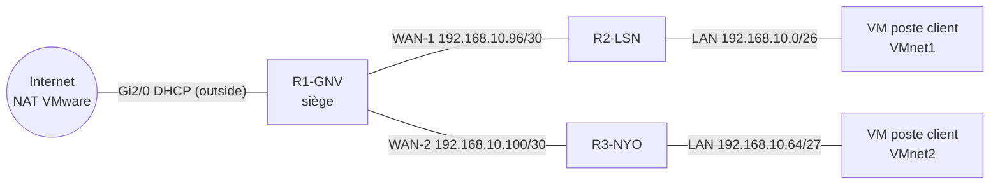

# Lab CCNA : VLSM, routage statique, NAT et administration SSH (GNS3 + VMware)

> Maquette hybride GNS3 / VMware d'un réseau d'entreprise sur trois sites (Genève, Lausanne, Nyon) : découpage VLSM, routage statique, sortie Internet par NAT et administration sécurisée des routeurs en SSH.

   

## Objectif

Une entreprise de logistique fictive veut relier son siège (Genève) à deux agences (Lausanne et Nyon) avec un seul bloc d'adresses `192.168.10.0/24`. Il faut :

- découper le bloc en sous-réseaux adaptés à chaque site (**VLSM**) ;
- assurer la connectivité entre sites par **routage statique** ;
- donner accès à Internet via **NAT/PAT** sur le routeur du siège ;
- administrer les routeurs à distance (SSH, Telnet demandé pour comparaison) ;
- faire communiquer de vraies machines virtuelles (Windows et Ubuntu) à travers la maquette.

*TP final ICND1/CCNA réalisé dans le cadre de la formation E1A au Geneva Institute of Technology. Le cas client est reformulé ; aucun énoncé de l'école n'est reproduit.*

## Topologie

## Plan d'adressage (VLSM)

| Segment | Réseau | Masque | Passerelle | Hôtes utilisables |
|---|---|---|---|---|
| LAN Lausanne | 192.168.10.0 | /26 (255.255.255.192) | 192.168.10.1 | 62 |
| LAN Nyon | 192.168.10.64 | /27 (255.255.255.224) | 192.168.10.65 | 30 |
| WAN-1 Genève ↔ Lausanne | 192.168.10.96 | /30 | .97 (R1) / .98 (R2) | 2 |
| WAN-2 Genève ↔ Nyon | 192.168.10.100 | /30 | .101 (R1) / .102 (R3) | 2 |
| Internet | DHCP (NAT VMware) | — | — | — |

Les plus grands sous-réseaux sont attribués en premier pour éviter le gaspillage d'adresses.

## Technologies

- **GNS3** (routeurs Cisco c7200, IOS 15.2) couplé à **VMware Workstation** (VMnet1, VMnet2, VMnet8)
- VM clientes Windows et Ubuntu
- Routage statique et routes par défaut
- **NAT overload (PAT)** avec ACL standard
- **SSH v2** (clé RSA, comptes locaux), Telnet
- Wireshark

## Étapes réalisées

1. Calcul du découpage VLSM et rédaction du plan d'adressage.
2. Construction de la maquette GNS3 et raccordement des VM via les cartes VMnet.
3. Adressage des interfaces et descriptions.
4. Routage : routes vers les LAN distants sur R1, route par défaut sur R2 et R3.
5. NAT : `ip nat inside` sur les liens internes, `ip nat outside` sur l'interface Internet, `ip nat inside source list 1 … overload`.
6. Sécurisation de l'accès : `enable secret`, utilisateur local, domaine, génération de la clé RSA, `ip ssh version 2`, `login local` sur les lignes VTY.
7. Tests : ping et traceroute de bout en bout, accès Internet depuis les VM, connexions SSH et Telnet depuis Windows et Ubuntu, captures Wireshark.

## Configurations

Les configurations sont dans [`configs/`](configs/). **Les hachés de mots de passe ont été remplacés par `<REDACTED>`** et les clés privées RSA des routeurs ne sont pas publiées.

## Analyse sécurité : SSH vs Telnet

Les captures Wireshark montrent la différence entre les deux protocoles : en Telnet, l'identifiant et le mot de passe circulent **en clair** et sont lisibles dans la capture ; en SSH, la session est chiffrée de bout en bout.

| Constat dans le lab | Recommandation |
|---|---|
| `transport input telnet ssh` (Telnet laissé actif pour la démonstration) | `transport input ssh` uniquement |
| `enable secret 5` (MD5) | `enable algorithm-type scrypt secret` (type 9) |
| Accès VTY ouvert à tout le réseau | `access-class` limitant l'administration au réseau d'admin |
| Pas de limitation des tentatives | `login block-for 120 attempts 3 within 60` |
| Pas de bannière ni de journalisation | `banner motd`, syslog, NTP |

## Compétences acquises

- Découpage VLSM et documentation d'un plan d'adressage
- Routage statique multi-sites et diagnostic (ping, traceroute, `show ip route`)
- NAT/PAT et vérification (`show ip nat translations`)
- Durcissement de l'accès d'administration (SSH v2, comptes locaux)
- Intégration GNS3 / VMware et interopérabilité Windows / Linux

## Reproduire le lab

1. GNS3 + image Cisco c7200 **sous licence** (non fournie), VMware Workstation.
2. Associer les nuages GNS3 aux cartes VMnet1, VMnet2 et VMnet8.
3. Appliquer les fichiers de `configs/` en remplaçant les `<REDACTED>` par vos propres mots de passe, puis `crypto key generate rsa modulus 2048`.

---
Auteure : **Rrudhani Deaa** — étudiante en réseaux et systèmes, orientée cybersécurité.
